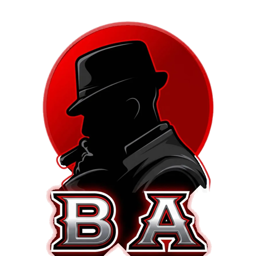

<div dir="rtl">

<p align="center"></p>

# Ba Studio

**استوديو مونتاج فيديو بالعربي يشتغل على جهازك، و Claude يعدّل الفيديو معك.**

قص، ترتيب، نصوص عربية، موسيقى، انتقالات، وتصدير بجودة عالية. كل المعالجة تتم على جهازك، وفيديوهاتك ما تنرفع لأي مكان.

## الجديد في 0.4.0

- **قبل كل تصميم يسألك «كيف تبي التصميم يكون؟»:** نوع التصميم (موشن جرافيك، رسم متحرك، عرض منتج، إعلان تطبيق، نص متحرك، إنفوجرافيك، شرح بخطوات، قصة بالصور، كشف شعار)، والصور، والأسلوب، والألوان (أو ألوان علامتك)، وخط العناوين، والإيقاع، والمدة، والانتقالات، وحركة الكاميرا.
- **الصور على كيفك:** صور حقيقية (يدوّر ويشوف ويختار ويذكر حقوقها)، أو صورك أنت، أو Claude يرسمها، أو بدون صور. ولصور احترافية أكثر ضيف مفتاح Pexels المجاني من الإعدادات.
- **أنيميشن:** رسوم خطية أنيقة تترسم وتتحرك، وملفات Lottie ترفعها أو تعطي رابطها.
- **صمّم من مرجع:** ارفع أي تصميم (فيديو أو صورة) من جهازك، وClaude يشوفه ويحلله بالتفصيل ويصمم بنفس الأسلوب.
- **بدون أي تصميم طفولي:** كل شي فخم ومرتب.

## الجديد في 0.3.0

- **محرك تصميم جديد:** Claude يصمم مشاهد إعلانية غنية (بطاقات، صور منتجات، جوال فيه شاشة، خطوط مرسومة، حركة كاميرا) ويحوّلها لفيديو على جهازك. يحتاج متصفح Edge أو Chrome.
- **أسلوب معتمد بدون تشابه:** ورق، لون قوي واحد، عناوين فخمة، وتفاصيل مرسومة باليد، مع ألوان وتكوينات وحركات مختلفة في كل طلب.
- **محادثة بعد كل طلب:** اكتب تعديلك («كبّر العنوان»، «غيّر لون المشهد الثاني») وClaude يكمل نفس المحادثة ويعدّل اللي طلبته بس.
- **صمّم من مرجع:** ارفع مقطع يعجبك تصميمه، والاستوديو يحلل قصّاته وألوانه وحركته وإيقاعه ويعرض صور منه، وClaude يشوفها ويصمم لك بنفس الأسلوب بمحتواك أنت.

## الجديد في 0.2.4

إصلاحات من فحص شامل للموقع:
- النص الطويل في الموشن والعناوين صار ينقسم على أسطر بدل ما ينقص من أطراف الفيديو.
- النص يظهر حرفيًا كما كتبته (رموز مثل %{n} ما عادت تتحول لأرقام).
- ما يقدر ينبدأ أكثر من طلب Claude بنفس اللحظة.
- رسائل خطأ واضحة لنسخة محفوظة تالفة، أو ملف تالف كخلفية موشن، أو مقاس مشروع غير صحيح.
- النص الجديد يبدأ بـ «عنوانك» بدل كلمة إنجليزية، وإصلاح مدة المقطع بعد التراجع.

## الجديد في 0.2.3

- إصلاح: الصفحة كانت تصير سوداء بعد تأكيد طلب «اطلب من Claude» في متصفح Chrome الجديد.
- إذا صار خطأ في الواجهة، تطلع رسالة فيها زر تحديث بدل صفحة فاضية.
- الاستوديو صار يلقى Claude Code إذا كان مثبّت عن طريق npm.

## الجديد في 0.2.2

- العناوين بخط عارف رقعة، وباقي الواجهة بخط أميري. الخطين مضمّنين داخل الاستوديو.

## الجديد في 0.2.1

- شعار Ba الجديد بخلفية شفافة.
- إصلاح: ما عاد ينفتح أكثر من نسخة من الاستوديو بنفس الوقت، فروابط الدخول صارت تشتغل دايمًا.

## الجديد في 0.2.0

- **اطلب من Claude داخل الاستوديو:** تكتب طلبك، و Claude يسوي لك مقاطع موشن جرافيك بدون ما ترفع فيديو خام، أو يعدّل مشروعك.
- **اقترح أفكار:** Claude يقترح أفكار لمشروعك، وتضغط أي فكرة وتعدّلها قبل التنفيذ.
- **لمسة بشرية:** تصميم بذوق مصمم حقيقي بدل الشكل المعتاد للذكاء الاصطناعي.
- **تنبيه قبل الخطوات الكبيرة:** قبل أي طلب يستهلك كثير من رصيد Claude، يطلع لك تنبيه، وبعد ما يخلص يعرض لك الاستهلاك.
- **خط ثمانية:** نصوص الفيديو تستخدم خط ثمانية إذا كان مثبّت عندك. رخصة الخط تمنع توزيعه، فنزّله مجانًا من [صفحة ثمانية الرسمية](https://thmanyah.open.cx/en/line-eight-for-everyone) وثبّته.

## التثبيت في Claude Code

### 1) المتطلبات (مرة وحدة)

افتح PowerShell ونفّذ الأمرين، كل واحد لحاله:

</div>

```powershell
winget install OpenJS.NodeJS.LTS
winget install Gyan.FFmpeg
```

<div dir="rtl">

بعدها سكّر Claude Code وافتحه من جديد.

### 2) أضف Ba Studio

اكتب هالأمرين داخل Claude Code:

</div>

```
/plugin marketplace add alwynybasl555-glitch/ba-studio
/plugin install ba-studio@ba-studio
```

<div dir="rtl">

أو بعد ما تضيف الأمر الأول، افتح `/plugin` وابحث عن **Ba Studio** وثبّته من هناك.

ثم أعد تشغيل Claude Code.

### 3) ابدأ

اكتب `/ba-studio:open` وبينفتح لك الاستوديو في المتصفح. أول مرة اضغط «نعم، اسمح لـ Claude».

بعدها اطلب من Claude أي شي بكلامك، مثلًا:

- «سوّ لي فيديو تيك توك 30 ثانية من مقاطع رحلتي مع موسيقى وعنوان»
- «شيل السكتات الطويلة من مقابلتي»
- «صدّر الفيديو بجودة عالية»

## الخصوصية والأمان

- الفيديو يُعالج على جهازك فقط.
- Claude يشوف أسماء الملفات ومددها وترتيب الخط الزمني فقط، وما يشوف الفيديو نفسه.
- Claude ما يقدر يحذف ملفاتك أو مشاريعك، وكل تعديل تقدر تتراجع عنه بـ Ctrl+Z.
- تقدر تخلي أي مشروع «خاص» عشان Claude ما يشوفه.
- لما تطلب من Claude داخل الاستوديو، يشتغل بحسابك ويستخدم أدوات الاستوديو بس: ما يقدر يفتح ملفاتك أو يشغّل أوامر أو يوصل لأي خدمة ثانية.

## التحديث

لما تنزل نسخة جديدة، احذف Ba Studio من قائمة `/plugin` وثبّته من جديد بنفس الطريقة.

الترخيص: Apache-2.0

</div>
